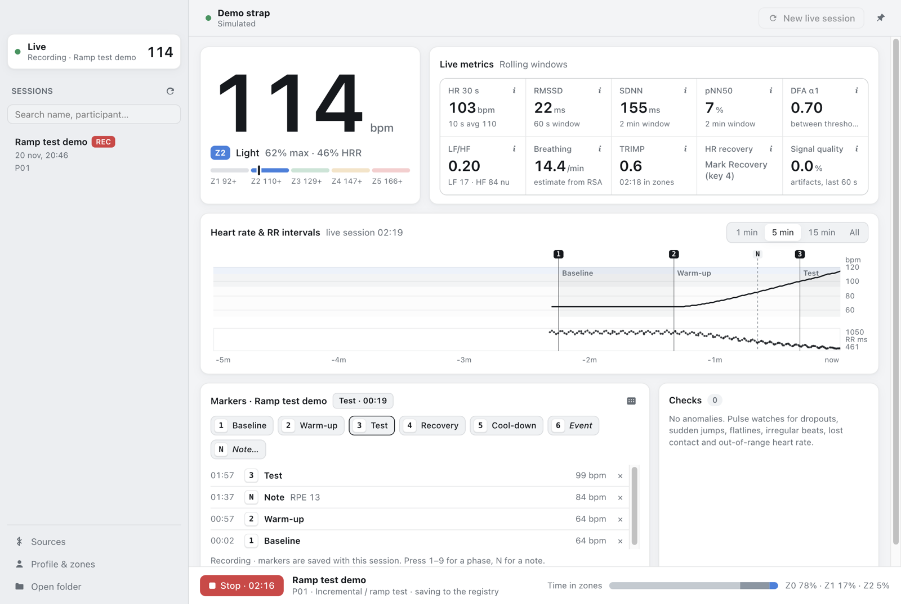
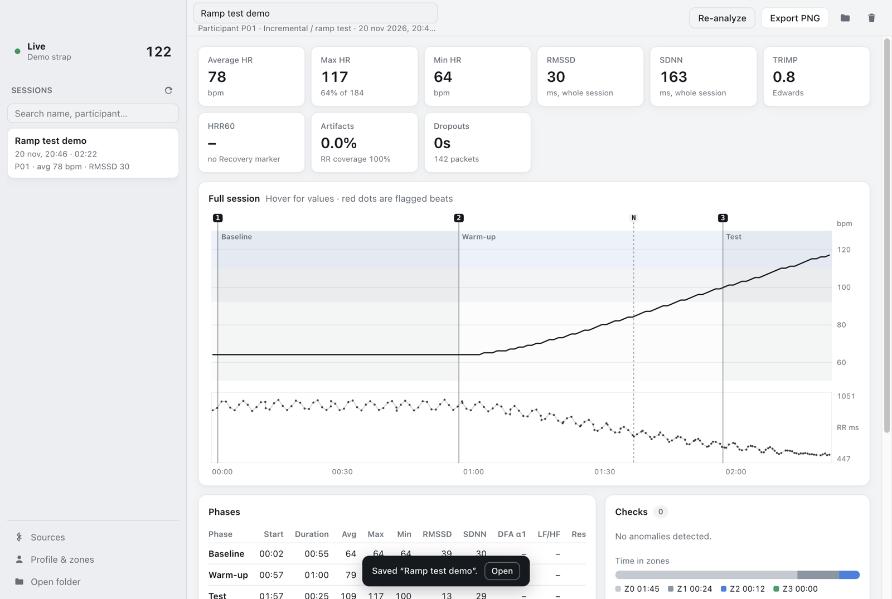

<p align="center"></p>

<h1 align="center">Pulse</h1>

<p align="center">A research-oriented heart rate recorder for macOS.<br>Any Bluetooth heart rate sensor, live HRV metrics, phase markers, anomaly checks, a session registry and PNG reports.</p>

<p align="center"><a href="https://github.com/vincenzodivincenzo/pulse/releases/latest"><b>Download for macOS</b></a> · Apple Silicon and Intel · macOS 12+</p>



## Install

1. Download `Pulse-<version>-universal.dmg` from the [latest release](https://github.com/vincenzodivincenzo/pulse/releases/latest).
2. Open the DMG and drag **Pulse** into **Applications**.
3. The first time, right-click Pulse in Applications and choose **Open**. On recent macOS versions, go to **System Settings › Privacy & Security** and click **Open Anyway**. Pulse is open source and not notarized by Apple, so macOS asks once.
4. Allow Bluetooth access when asked.

If macOS still refuses to open it, run this once in Terminal:

```bash
xattr -dr com.apple.quarantine /Applications/Pulse.app
```

## What it does

- **Finds your sensor automatically.** On launch Pulse scans for the standard Bluetooth Heart Rate service, connects to the sensor you used last (or the first known strap brand), and reconnects by itself when the signal drops.
- **Live research metrics.** HR 10/30 s, %HRmax and %HRR, RMSSD, SDNN, pNN50, DFA α1, LF/HF, breathing rate from RSA, Edwards TRIMP, heart rate recovery and signal quality, each with an explanation one click away.
- **Standard zones.** Five zones at 50–60, 60–70, 70–80, 80–90 and 90–100% of max HR, or of heart rate reserve (Karvonen) when a resting HR is set. Max HR is entered or estimated from age (Tanaka).
- **Phase markers and notes.** Keys 1–9 drop configurable markers (Baseline, Warm-up, Test, Recovery…). Phase markers label every reading until the next phase. N adds a timestamped free note.
- **Anomaly checks.** Dropouts, sudden jumps, flatlines, lost skin contact, implausible values, bursts of irregular beats, heart rate above the profile max, low HR and elevated resting HR.
- **Named sessions in a registry.** Every recording needs a name and can carry a participant ID, protocol, profile and notes. Sessions are searchable, renamable, and can be re-analyzed from the raw files at any time.
- **PNG reports.** One click exports a printable report: metadata, summary, full chart with phases and markers, RR tachogram, time in zones, per-phase table and anomalies.



## Sources

| Source | How |
| --- | --- |
| Chest straps and armbands | Garmin HRM series, Polar H9/H10/Verity, Wahoo TICKR, Coros, Suunto, Scosche, Coospo, Magene and any sensor with the standard Heart Rate profile. Chest straps send RR intervals, which the HRV metrics need. |
| Watches | Garmin, Polar, Suunto, Coros, Whoop and others in heart rate broadcast mode. Watches usually send BPM only, so HRV tiles show “Needs RR”. |
| Network input | Any app, phone, script or Apple Watch relay on the local network (see below). |
| Demo | A simulated strap with realistic RR intervals, for trying the app or training staff. |

### Network input

Turn it on in **Sources**. Pulse listens on port 8787 and shows the URL and token to use.

```bash
curl -X POST http://<your-mac>:8787/hr \
  -H "X-Pulse-Token: <token>" \
  -d '{"bpm": 72, "rr": [812, 830], "source": "Apple Watch"}'
```

A plain GET also works, which suits Shortcuts and simple devices:

```
http://<your-mac>:8787/hr?bpm=72&rr=812,830&token=<token>
```

`bpm` must be 20–250. `rr` is optional, in milliseconds. A connected Bluetooth sensor takes priority over network input.

## Keyboard

| Key | Action |
| --- | --- |
| 1–9 | Drop the marker assigned to that key |
| N | Add a note, timestamped when you press N |
| Enter / Esc | Save / cancel the note |

Keys work whenever you are not typing in a field.

## Session files

Each recording is a folder in `~/Documents/Pulse`, named `YYYY-MM-DD_HH-MM <session name>`:

| File | Contents |
| --- | --- |
| `heart_rate.csv` | One row per packet: timestamp, elapsed_s, bpm, rr_ms, contact, source, phase, marker. Written live, so a crash keeps the data. |
| `markers.csv` | Every marker with time, key, label, type (phase, event, note), note and bpm. |
| `anomalies.csv` | Every check that fired, with start, end, type, severity and detail. |
| `rr_intervals.txt` | Clean RR intervals in ms, one per line, ready for Kubios HRV. |
| `session.json` | Name, participant, protocol, notes, profile, zones, overall and per-phase metrics, recovery, quality and anomalies. |

## Metrics

| Metric | Definition | Reference |
| --- | --- | --- |
| RMSSD | Root mean square of successive RR differences, 60 s window | Task Force of the ESC and NASPE, 1996 |
| SDNN | Standard deviation of clean RR intervals, 2 min window | Task Force, 1996 |
| pNN50 | Share of successive differences over 50 ms | Task Force, 1996 |
| LF/HF | Lomb-Scargle power 0.04–0.15 Hz over 0.15–0.4 Hz, 5 min window, rest only | Task Force, 1996 |
| Breathing rate | Dominant RR oscillation in 0.1–0.5 Hz (respiratory sinus arrhythmia) | |
| DFA α1 | Detrended fluctuation analysis, box sizes 4–16 beats, 2 min window | Rogers et al., 2021 |
| TRIMP | Minutes in zone × zone number | Edwards, 1993 |
| HRR60 / HRR120 | Peak HR in the 30 s before a Recovery or Cool-down marker minus HR 60 / 120 s later | Cole et al., 1999 |
| Max HR estimate | 208 − 0.7 × age | Tanaka et al., 2001 |

RR artifacts are flagged when an interval is outside 300–2000 ms or more than 20% from the median of the previous clean beats. Flagged beats are excluded from HRV metrics and shown as red dots on the tachogram.

## Build from source

```bash
git clone https://github.com/vincenzodivincenzo/pulse.git
cd pulse
npm install
npm start
```

```bash
npm run demo
```

```bash
npm run package:universal && npm run dmg
```

The DMG lands in `dist/`.

## Privacy

Everything stays on your Mac. Pulse makes no outgoing network requests. Network input is off by default, listens only on your local network, and requires the token.

## Disclaimer

Pulse is for research, training and education. It is not a medical device and does not diagnose anything. Anomaly checks flag data patterns worth a second look, not medical conditions.

## License

MIT
